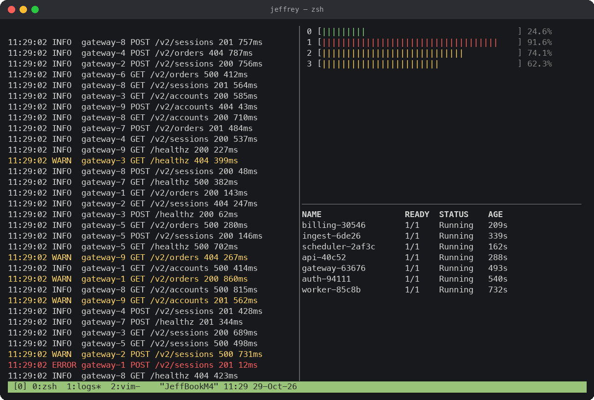
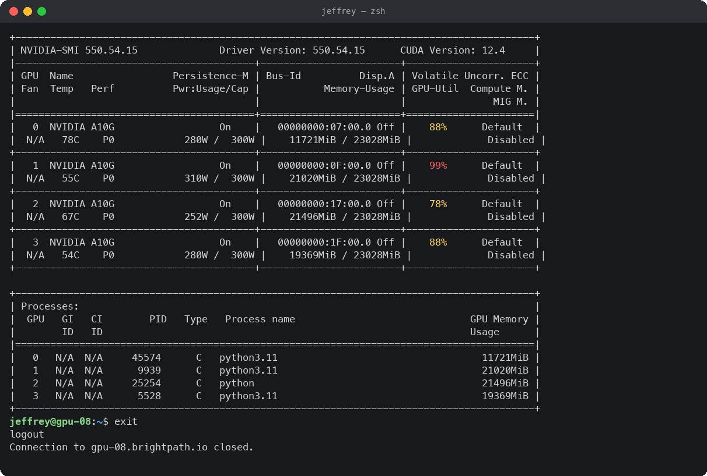
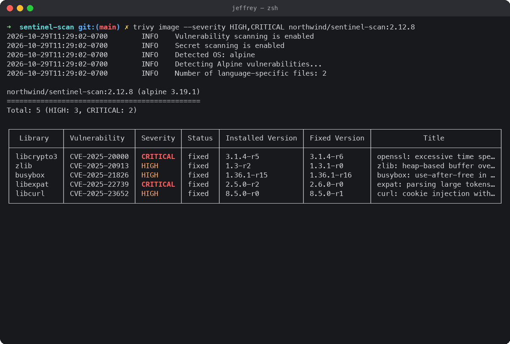

# kayfabe

A fake terminal that makes your computer look busy. It types commands, runs
builds, fails tests, fixes them, and fills the screen with dashboards, charts
and logs, none of it real.


| | |
|---|---|
|  |  |
|  |  |
|  |  |
|  |  |
|  | |

## Run it

```
./kayfabe            # Ctrl+C to quit
./kayfabe --speed 2  # twice as fast; 0.5 is slower
./kayfabe --role sec # look like a particular job: dev, it, data, sec, ops (default: all)
```

One Python file, standard library only, Python 3.8+. Copy it to any Mac and run it.

## What you'll see

About 60 scenarios per project type, picked at random and never repeated back to back.

- **Dev work:** git pull/push/merge conflicts, npm, pip, cargo and go builds, pytest and jest runs (failures get fixed in vim, then re-run), docker builds and pulls, kubectl, terraform, CI runs, releases with a gradient banner.
- **IT admin:** PowerShell remoting into a domain controller (`Get-ADUser`, lockouts, `ipconfig /all`, `pathping`, `repadmin`, `dcdiag`), `dig` in eight flavors including `+trace` and DNSSEC, `nmap` scans, `tcpdump`, `openssl s_client`, `mtr`, Ansible playbooks, backups, `brew upgrade`.
- **Data / ML:** training runs with live epoch bars and loss sparklines, `nvidia-smi` on a GPU box, papermill notebook runs, pandas in a REPL, classification reports with a confusion matrix.
- **Databases:** `psql` sessions against RDS (aggregates, `EXPLAIN ANALYZE`), `redis-cli` against ElastiCache.
- **Security:** `trivy` image scans, `fail2ban` logs, `nikto`, `npm audit` / `pip-audit`.
- **Microsoft 365 / cloud admin:** `pwsh` with Exchange Online, Microsoft Graph, Intune and SCCM cmdlets.
- **Pagers and multiplexers:** `man`, `less` with a search, a three-pane `tmux` layout; plus CMake and `xcodebuild` build logs and `git log --graph`.
- **Story arcs:** some scenes chain into one believable story (see below).
- **Graphics:** a live ops dashboard, scrolling area charts, network traffic lanes, a subnet latency map, certificate expiry bars, a GoAccess-style panel, request traces, flame graphs, a commit heatmap, matrix rain.

Everything is randomized: hostnames, hashes, timings, names, commit messages, and the pacing itself, which swings between bursts and lulls.

Every few commands it stops at a prompt (deploy? password? host key?). If you
type something it accepts it; if you don't, it waits a few seconds and answers
for itself.

## Story arcs

Most scenes stand alone. An arc is a short story told across several scenes, with
the same service, file, user or error carried from step to step. Arcs are picked
like any other scene, filtered by project type, and nothing else interrupts one
until it finishes.

| Arc | Project types | The story |
|---|---|---|
| **Incident** | all | `kubectl get pods` shows a pod in `CrashLoopBackOff`, `kubectl logs --previous` shows the cause (exhausted DB pool, nil pointer, OOMKilled or a missing config key), `grep` finds the file, vim fixes it, then commit, push, a CI run, `kubectl rollout status`, pods green and a `/healthz` check. |
| **Red tests** | python, node, rust, data, sec | The test suite fails, the failure is read, the code is fixed in vim, the tests pass, then commit, push and CI. |
| **Vulnerable image** | all | `trivy` flags a CRITICAL CVE in a library, `grep` finds where it is pinned, vim bumps the version, `docker build`, `trivy` again shows `Total: 0`, then commit and push. |
| **Locked-out user** | it | `Enter-PSSession` into a domain controller, `Get-ADUser` shows `LockedOut: True`, event 4740 names the source workstation, `Unlock-ADAccount`, a recheck, `Exit-PSSession`, then a ping to the workstation. |
| **DNS trouble** | it, infra | `dig` returns SERVFAIL, `dig @dc` against the internal resolver answers, the local DNS cache is flushed (sudo prompt), then `dig +short` and `curl -I` come back 200. |
| **Diverging model** | data | A training run hits NaN loss and stops, `grep` finds the learning rate, vim lowers it and adds gradient clipping, the rerun trains cleanly, then commit and push. |
| **Brute-force ban** | sec, it, infra | `tail -f fail2ban.log` shows repeated failures from one IP, `grep | sort | uniq -c` of the auth log confirms it, `fail2ban-client set sshd banip` and the jail status follow. |
| **Slow query** | all | `psql` into RDS, `EXPLAIN ANALYZE` shows a parallel sequential scan, `CREATE INDEX CONCURRENTLY` runs, and the second `EXPLAIN ANALYZE` shows an index scan in a fraction of the time. |

## It's harmless

It only prints text. It makes no network calls, runs no subprocesses, reads and
writes no files, and sends no keystrokes to the OS. Anything you type at one of
its prompts is thrown away. The only things it reads from the machine are your
username, hostname, macOS version and CPU count, for realism (it shows up in the prompt, `whoami`, `fastfetch` and `uname`). The window title is set to look like Terminal.app's, and it redraws if you resize the window. Hostnames, domains, AWS
accounts and companies in the output are invented.

## License

MIT
