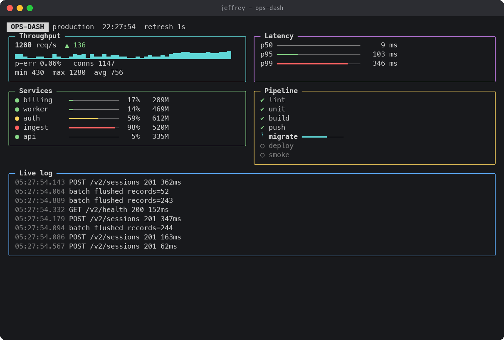
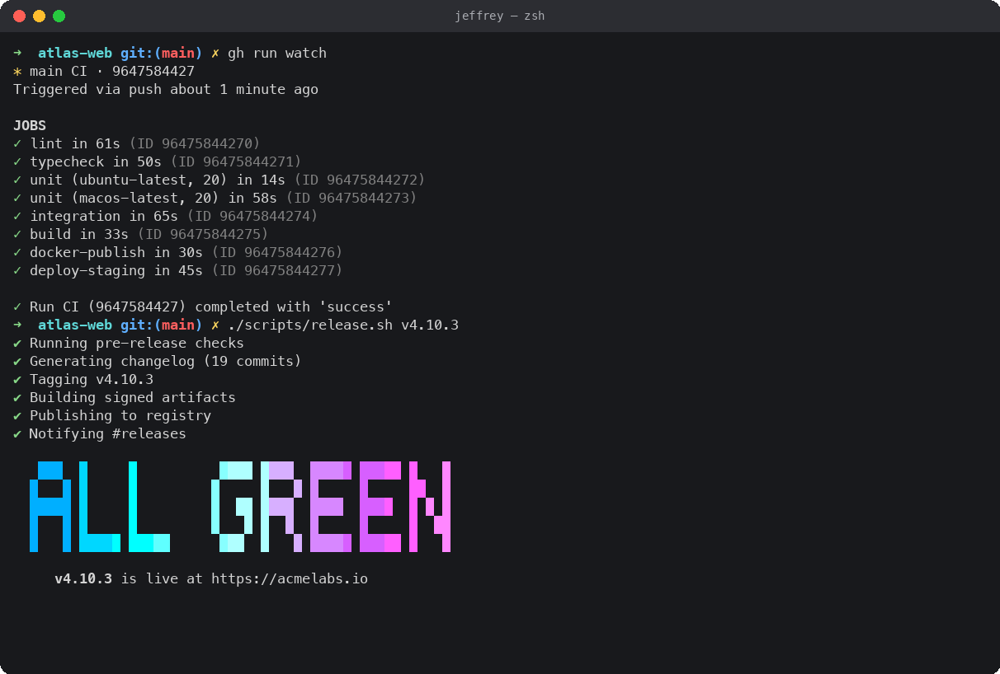
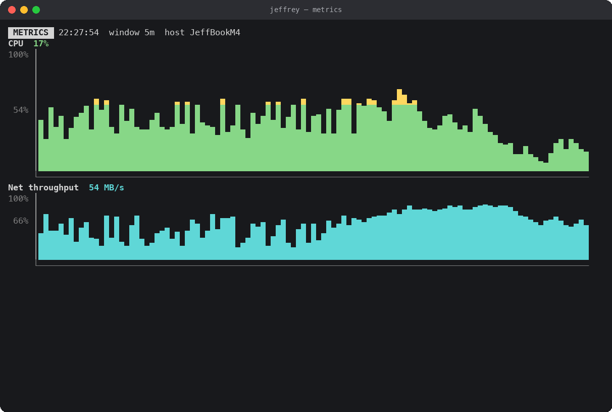
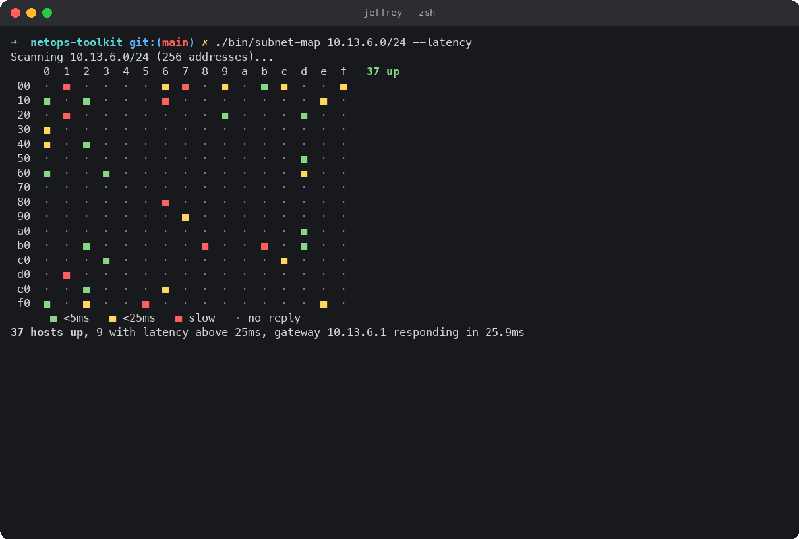
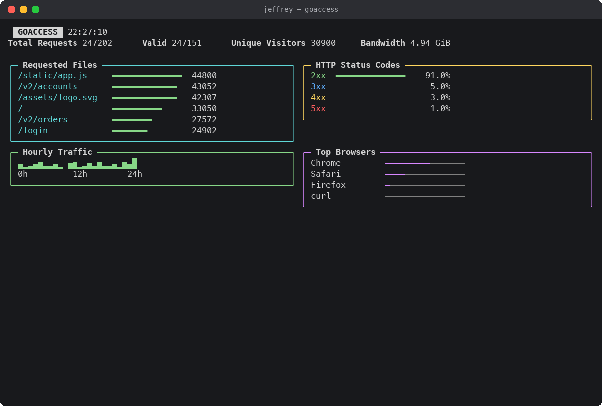
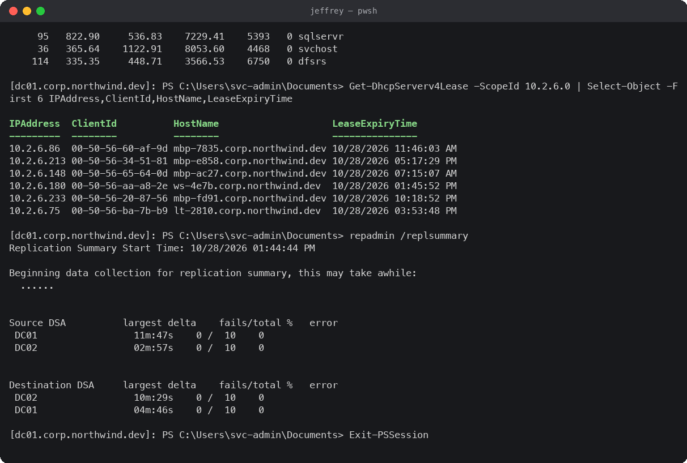
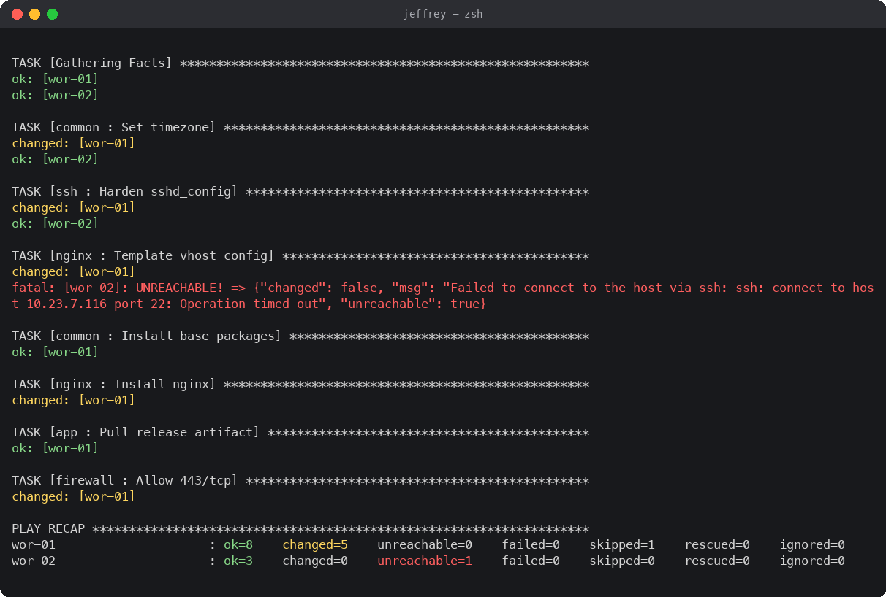

# kayfabe

A fake terminal that makes your computer look busy. It types commands, runs
builds, fails tests, fixes them, and fills the screen with dashboards, charts
and logs, none of it real.



| | |
|---|---|
|  |  |
|  |  |
|  |  |

## Run it

```
./kayfabe            # Ctrl+C to quit
./kayfabe --speed 2  # twice as fast; 0.5 is slower
```

One Python file, standard library only, Python 3.8+. Copy it to any Mac and run it.

## What you'll see

About 50 scenarios per project type, picked at random and never repeated back to back.

- **Dev work:** git pull/push/merge conflicts, npm, pip, cargo and go builds, pytest and jest runs (failures get fixed in vim, then re-run), docker builds and pulls, kubectl, terraform, CI runs, releases with a gradient banner.
- **IT admin:** PowerShell remoting into a domain controller (`Get-ADUser`, lockouts, `ipconfig /all`, `pathping`, `repadmin`, `dcdiag`), `dig` in eight flavors including `+trace` and DNSSEC, `nmap` scans, `tcpdump`, `openssl s_client`, `mtr`, Ansible playbooks, backups, `brew upgrade`.
- **Graphics:** a live ops dashboard, scrolling area charts, network traffic lanes, a subnet latency map, certificate expiry bars, a GoAccess-style panel, request traces, flame graphs, a commit heatmap, matrix rain.

Everything is randomized: hostnames, hashes, timings, names, commit messages, and the pacing itself, which swings between bursts and lulls.

Every few commands it stops at a prompt (deploy? password? host key?). If you
type something it accepts it; if you don't, it waits a few seconds and answers
for itself.

## It's harmless

It only prints text. It makes no network calls, runs no subprocesses, reads and
writes no files, and sends no keystrokes to the OS. Anything you type at one of
its prompts is thrown away. The only thing it reads from the machine is your
username, hostname and macOS version, for realism. Hostnames, domains, AWS
accounts and companies in the output are invented.

## License

MIT
